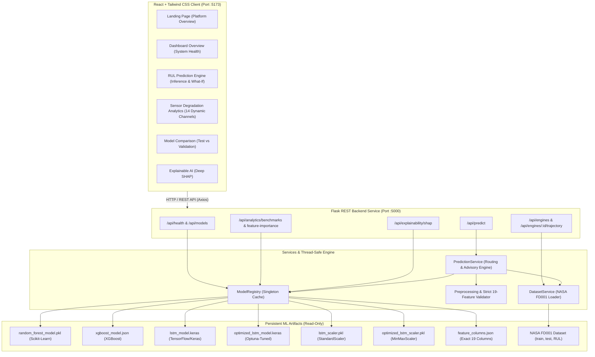

# Industrial Intelligence: Turbofan Engine Remaining Useful Life (RUL) Prediction Platform

[](https://www.python.org/)
[](https://flask.palletsprojects.com/)
[](https://react.dev/)
[](https://vitejs.dev/)
[](https://tailwindcss.com/)
[](https://keras.io/)
[](https://scikit-learn.org/)
[](https://xgboost.readthedocs.io/)

A production-grade Predictive Maintenance & Prognostics platform for commercial turbofan engines, powered by machine learning and sequential deep learning architectures trained on the **NASA C-MAPSS FD001** benchmark.

---

## 1. Problem Statement & Motivation

Industrial gas turbine and turbofan engines operate under intense thermodynamic stresses, where unexpected mechanical failure leads to severe operational disruption, astronomical unscheduled maintenance costs, and critical safety hazards.

Traditional maintenance models operate on either:
* **Corrective Maintenance (Run-to-Failure):** Results in catastrophic component damage and extended downtime.
* **Periodic Preventative Maintenance (Fixed Time Intervals):** Replaces components prematurely while they still retain significant operational life.

**Condition-Based Predictive Maintenance (PdM)** uses continuous telemetry from multi-point sensor arrays to infer internal degradation dynamics and accurately forecast **Remaining Useful Life (RUL)**—the exact number of operational cycles an engine can safely continue running before requiring depot-level maintenance.

---

## 2. NASA C-MAPSS FD001 Benchmark Dataset

The platform is evaluated on the **Commercial Modular Aero-Propulsion System Simulation (C-MAPSS)** dataset generated by NASA Glenn Research Center:

* **Engine Architecture:** Dual-spool turbofan engine with High-Pressure Compressor (HPC), High-Pressure Turbine (HPT), Low-Pressure Compressor (LPC), Low-Pressure Turbine (LPT), and bypass duct.
* **Fault Mode:** High-Pressure Compressor (HPC) degradation:
  * Simulated HPC flow capacity reduction (-1.5%)
  * Simulated HPC adiabatic efficiency loss (-1.0%)
* **Operating Conditions:** Sea-level, single flight condition (Sea Level Standard Day, Mach 0.0, Altitude 0 ft).
* **Dataset Divisions:**
  * **Training Set (`train_FD001.txt`):** 100 engines run continuously from initial health until mechanical failure (20,631 total cycles).
  * **Test Set (`test_FD001.txt`):** 100 test engines truncated at an arbitrary operational cycle prior to failure (13,096 cycles).
  * **Test Labels (`RUL_FD001.txt`):** Ground-truth actual RUL remaining after test cutoff for each of the 100 test engines.

### Sensor Channel Allocation & Feature Vector Selection

The raw NASA C-MAPSS telemetry delivers 26 columns: `engine_id`, `cycle`, 3 operational settings (`op_setting_1`, `op_setting_2`, `op_setting_3`), and 21 sensor measurements (`sensor_1` through `sensor_21`).

During exploratory data analysis and feature engineering (`02_sensor_analysis.py`, `05_feature_engineering.py`), sensor variance across all 20,631 training cycles was calculated:
* **6 Non-Informative / Constant Sensors Dropped:**  
  `sensor_1` ($T_2$, 518.67 °R), `sensor_5` ($P_2$, 14.62 psia), `sensor_10` ($P_{20}/P_2$, 1.30), `sensor_16` ($FAR$, 0.03), `sensor_18` ($N_{f,dmd}$, 2388 rpm), and `sensor_19` ($N_{c,dmd}$, 100 %) exhibit zero variance ($\sigma = 0$) under sea-level standard day conditions and are dropped.
* **15 Active Sensor Channels Retained in the 19-Feature Model Vector:**  
  The remaining **15 sensor channels** (`sensor_2`, `sensor_3`, `sensor_4`, `sensor_6`, `sensor_7`, `sensor_8`, `sensor_9`, `sensor_11`, `sensor_12`, `sensor_13`, `sensor_14`, `sensor_15`, `sensor_17`, `sensor_20`, `sensor_21`) along with the **3 operational settings** and the **operational cycle** constitute the exact **19 active input features** (`feature_columns.json`).
* **Visual Trajectory Channel Selection in Analytics UI:**  
  Within the interactive Sensor Analytics interface, **14 channels** exhibiting dynamic wear trajectories are visualized in degradation charts. Channel `sensor_6` ($P_{15}$, Total pressure in bypass duct) is intentionally excluded from the timeline trend charts because it exhibits near-zero variance ($21.60 - 21.61\text{ psia}$, $\mu = 21.6098$, $\sigma = 0.00139$) under single-condition flight dynamics, providing negligible visual degradation trend signal. However, `sensor_6` remains strictly present in the 19-feature model input vector and within tree-based feature importance calculations.

The exact 19 features in canonical model order are:

| Index | Feature Key | NASA Symbol | Component Description | Unit | Healthy Baseline | Degraded Limit | Verified Lifecycle Trend |
| :---: | :--- | :--- | :--- | :--- | :--- | :--- | :--- |
| 0 | `cycle` | — | Time in Operational Cycles | cycles | 1 | Failure | **Chronological elapsed run-time** |
| 1 | `op_setting_1` | — | Operational Setting 1 (Altitude) | norm | Fixed | Fixed | **Control setting** (Sea level) |
| 2 | `op_setting_2` | — | Operational Setting 2 (Mach Number) | norm | Fixed | Fixed | **Control setting** (Mach 0.0) |
| 3 | `op_setting_3` | — | Operational Setting 3 (TRA) | norm | Fixed | Fixed | **Control setting** (TRA 100) |
| 4 | `sensor_2` | $T_{24}$ | Total Temperature at LPC Outlet | °R | ~642.0 – 642.7 | ~643.5 – 644.5 | **Upward drift** ($\Delta_{\text{avg}} = +0.50\text{ °R}$) |
| 5 | `sensor_3` | $T_{30}$ | Total Temperature at HPC Outlet | °R | ~1585 – 1595 | ~1605 – 1617 | **Upward drift** ($\Delta_{\text{avg}} = +6.13\text{ °R}$) |
| 6 | `sensor_4` | $T_{50}$ | Total Temperature at LPT Outlet | °R | ~1390 – 1405 | ~1420 – 1441 | **Upward drift** ($\Delta_{\text{avg}} = +28.58\text{ °R}$) |
| 7 | `sensor_6` | $P_{15}$ | Total Pressure in bypass-duct | psia | ~21.61 | ~21.61 | **Nominally flat** ($\Delta_{\text{avg}} \approx 0$, $\sigma = 0.0014$) |
| 8 | `sensor_7` | $P_{30}$ | Total Pressure at HPC Outlet | psia | ~553.5 – 555.5 | ~549.8 – 551.0 | **Downward drift** ($\Delta_{\text{avg}} = -2.60\text{ psia}$) |
| 9 | `sensor_8` | $N_f$ | Physical Fan Speed | rpm | ~2388.0 | ~2388.3 | **Upward drift** ($\Delta_{\text{avg}} = +0.20\text{ rpm}$) |
| 10 | `sensor_9` | $N_c$ | Physical Core Speed | rpm | ~9040 – 9065 | ~9100 – 9245 | **Upward drift** ($\Delta_{\text{avg}} = +44.40\text{ rpm}$) |
| 11 | `sensor_11` | $Ps_{30}$ | Static Pressure at HPC Outlet | psia | ~46.9 – 47.1 | ~48.2 – 48.5 | **Upward drift** ($\Delta_{\text{avg}} = +0.84\text{ psia}$) |
| 12 | `sensor_12` | $\phi$ | Ratio of Fuel Flow to $Ps_{30}$ | pps/psi | ~522.0 – 523.0 | ~518.7 – 520.0 | **Downward drift** ($\Delta_{\text{avg}} = -2.24\text{ pps/psi}$) |
| 13 | `sensor_13` | $NR_f$ | Corrected Fan Speed | rpm | ~2388.0 | ~2388.3 | **Subtle shift** ($\Delta_{\text{avg}} = +0.07\text{ rpm}$) |
| 14 | `sensor_14` | $NR_c$ | Corrected Core Speed | rpm | ~8130 – 8145 | ~8170 – 8294 | **Upward drift** ($\Delta_{\text{avg}} = +31.62\text{ rpm}$) |
| 15 | `sensor_15` | $BPR$ | Bypass Ratio | — | ~8.40 – 8.44 | ~8.50 – 8.58 | **Upward drift** ($\Delta_{\text{avg}} = +0.04$) |
| 16 | `sensor_17` | $htBleed$ | Bleed Enthalpy | BTU/lbm | ~391 – 393 | ~397 – 400 | **Upward drift** ($\Delta_{\text{avg}} = +1.55\text{ BTU/lbm}$) |
| 17 | `sensor_20` | $W_{31}$ | HPT Coolant Bleed | lbm/s | ~38.8 – 39.0 | ~38.1 – 38.4 | **Downward drift** ($\Delta_{\text{avg}} = -0.36\text{ lbm/s}$) |
| 18 | `sensor_21` | $W_{32}$ | LPT Coolant Bleed | lbm/s | ~23.3 – 23.4 | ~22.9 – 23.1 | **Downward drift** ($\Delta_{\text{avg}} = -0.22\text{ lbm/s}$) |

---

## 3. Data Preprocessing & Target Formulation

1. **Piecewise Linear RUL Target Function:**  
   During early operational cycles, components exhibit negligible wear; assigning true linear RUL causes models to attempt predicting wear patterns before degradation physically exists. In accordance with standard prognostic literature, target RUL is capped at $RUL_{\text{max}} = 125\text{ cycles}$:
   $$\text{RUL}_{\text{target}}(t) = \min(125, \text{MaxCycle} - t)$$
2. **Train/Validation Split by Engine ID (80/20 Engine Split):**  
   To prevent data leakage across sliding time windows, the 100 training engines are strictly partitioned **by engine ID** using Scikit-Learn's `train_test_split(engine_ids, test_size=0.20, random_state=42)`. This yields 80 training engines (16,561 records / 14,241 sliding windows) and 20 held-out validation engines (4,070 records / 3,490 sliding windows). Validation was performed strictly on this 80/20 engine-level partition, never via K-Fold cross-validation, guaranteeing zero engine overlap.
3. **Model-Specific Scalers & Input Shapes:**
   * **Tabular Models (Random Forest & XGBoost):** Evaluated on single-cycle snapshots of 2D shape $(N, 19)$ using raw, unscaled physical values.
   * **Baseline LSTM:** Scaled using `StandardScaler` (z-score normalization fitted on the 80 training engines) structured as 3D tensors of shape $(N, 30, 19)$.
   * **Optimized LSTM:** Scaled using `MinMaxScaler` ($[0, 1]$ normalization fitted on the 80 training engines) structured as 3D tensors of shape $(N, 30, 19)$.
4. **Strict Rejection of Synthetic Padding:**  
   To preserve prognostic validity, zero-padding or synthetic sensor interpolation is strictly forbidden. Sequence models accept **exactly 30 consecutive chronological cycles**.

---

## 4. Evaluated Machine Learning Models

### 1. Random Forest Regressor
* **Architecture:** 150 independent decision trees (`n_estimators=150`, `max_depth=15`, `min_samples_split=5`, `min_samples_leaf=2`, `random_state=42`, `n_jobs=-1`).
* **Input:** Single-cycle 2D snapshot $(1, 19)$ using raw physical features.
* **Characteristics:** Extremely fast inference ($\approx 4\text{ ms}$), captures non-linear feature interactions without feature normalization, but lacks temporal awareness.

### 2. XGBoost Regressor
* **Architecture:** Gradient boosted decision trees (`num_boosted_rounds=187`, `learning_rate=0.3`, `max_depth=6`, `objective="reg:squarederror"`).
* **Input:** Single-cycle 2D snapshot $(1, 19)$ using raw physical features.
* **Characteristics:** Highly sensitive to individual sensor thresholds ($Ps_{30}$, $T_{50}$), achieves superior single-cycle accuracy compared to bagging ensembles.

### 3. Baseline LSTM
* **Architecture:** 2-layer stacked Recurrent Neural Network (34,465 trainable parameters):
  * LSTM Layer 1: 64 hidden units (returns sequences, `activation='tanh'`, `recurrent_activation='sigmoid'`) + Dropout (0.2)
  * LSTM Layer 2: 32 hidden units (last time step, `activation='tanh'`, `recurrent_activation='sigmoid'`) + Dropout (0.2)
  * Dense Projection Layer: 16 units (`activation='relu'`)
  * Dense Output: 1 linear unit (`activation='linear'`)
* **Input:** Sequential 3D tensor $(1, 30, 19)$ scaled with `StandardScaler` (z-score normalization fitted on the 80 training engines).
* **Training & Optimization:** Trained for 14 epochs using Adam optimizer (initial learning rate 0.001, decayed at epoch 10 to 0.0005, final optimizer state 0.00025) with Mean Squared Error (`mse`) loss.
* **Characteristics:** Learns continuous temporal degradation trajectories across 30 consecutive operating cycles.

### 4. Optuna-Tuned Optimized LSTM (Benchmark Winner)
* **Architecture:** Optimized recurrent architecture discovered through automated Optuna Bayesian optimization (10,369 trainable parameters):
  * LSTM Layer 1: 32 hidden units (returns sequences, `activation='tanh'`, `recurrent_activation='sigmoid'`) + Dropout (0.1)
  * LSTM Layer 2: 16 hidden units (last time step, `activation='tanh'`, `recurrent_activation='sigmoid'`) + Dropout (0.1)
  * Dense Projection Layer: 32 units (`activation='relu'`)
  * Dense Output: 1 linear unit (`activation='linear'`)
* **Input:** Sequential 3D tensor $(1, 30, 19)$ scaled with `MinMaxScaler` ($[0, 1]$ normalization fitted on the 80 training engines).
* **Training & Optimization:** Trained with Adam optimizer (learning rate 0.001) with Mean Squared Error (`mse`) loss.
* **Characteristics:** Compact parameter footprint, superior gradient flow, achieving the lowest test error (MAE 9.92) and lowest asymmetric NASA penalty score (302.95).

---

## 5. Verified Evaluation Results & Benchmark Metrics

Two separate evaluation protocols are maintained:
1. **Official NASA Test Set:** Evaluated on all 100 test engines with ground-truth cutoff labels from `RUL_FD001.txt`.
2. **Internal Validation Set:** Evaluated on the 20 held-out validation engines from the 80/20 engine-level split (4,070 records / 3,490 sliding sequences).

### Official NASA FD001 Test Set Performance (100 Engines)

| Model Architecture | MAE (Cycles) | RMSE (Cycles) | Explained Variance ($R^2$) | NASA Penalty Score | Status |
| :--- | :---: | :---: | :---: | :---: | :---: |
| **Random Forest** | 13.3821 | 17.8955 | 0.8145 | 529.51 | Baseline Tabular |
| **XGBoost Regressor** | 13.2552 | 17.6988 | 0.8186 | 543.50 | Boosted Tabular |
| **Baseline LSTM** | 10.5960 | 14.0061 | 0.8864 | 311.91 | Baseline Sequence |
| **Optimized LSTM (Optuna)** | **9.9228** | **13.9583** | **0.8872** | **302.95** | **Top Performer** |

> **Evaluation Metrics Defined:**
> * **MAE (Mean Absolute Error):** Average cycle prediction deviation (lower is better).
> * **RMSE (Root Mean Squared Error):** Penalizes large outlier errors (lower is better).
> * **$R^2$ (Coefficient of Determination):** Fraction of degradation variance captured (closer to 1.0 is better).
> * **NASA Penalty Score:** Asymmetric scoring function where late predictions (predicting engine will survive longer than it actually does) are penalized exponentially heavier than early predictions:
>   $$S = \sum_{i=1}^{N} \begin{cases} e^{-\frac{d_i}{13}} - 1, & d_i < 0 \text{ (Early prediction)} \\ e^{\frac{d_i}{10}} - 1, & d_i \ge 0 \text{ (Late prediction)} \end{cases} \quad \text{where } d_i = \hat{y}_i - y_i$$

### Internal Validation Set Benchmarks (80/20 Engine Split: 20 Held-Out Engines)

| Model Architecture | MAE (Cycles) | RMSE (Cycles) | $R^2$ Score | NASA Penalty Score |
| :--- | :---: | :---: | :---: | :---: |
| **Random Forest** | 12.4565 | 17.1984 | 0.8303 | 22,277.49 |
| **XGBoost Regressor** | 12.3260 | 16.7594 | 0.8389 | 19,680.41 |
| **Baseline LSTM** | 9.2978 | 12.4565 | 0.9110 | 10,080.01 |
| **Optimized LSTM** | **7.9672** | **11.5566** | **0.9234** | — |

---

## 6. Model Explainability: GradientExplainer (Deep SHAP)

To prevent deep learning "black box" hazards in aviation health monitoring, model explainability is implemented using **`shap.GradientExplainer` (Expected Gradients for Deep Neural Networks)**:

```
Mean Absolute SHAP Attribution Ranking (Baseline LSTM)
1. Physical Fan Speed (sensor_8)                  ████████████████████  0.6256
2. Static Pressure at HPC Outlet (sensor_11)       ██████████████████    0.5770
3. Total Pressure at HPC Outlet (sensor_7)        ████████████████      0.5069
4. Corrected Fan Speed (sensor_13)                ███████████████       0.4970
5. Fuel Flow to Ps30 Ratio (sensor_12)            ███████████████       0.4824
6. Operational Cycle (cycle)                       █████████████         0.4351
7. Total Temperature at LPT Outlet (sensor_4)     ████████████          0.3940
8. Total Temperature at LPC Outlet (sensor_2)     ██████████            0.3332
```

### Key Interpretability Principles
1. **Mathematical Attribution vs Physical Causation:** SHAP values quantify the mathematical sensitivity of the neural network's numerical output with respect to input perturbations. They do **not** represent aerodynamic root causes or replace physical borescope inspections.
2. **Temporal Window Dynamics:** Gradient heatmaps across the 30-cycle observation window confirm that attribution concentrates heavily in the final 5–10 operational cycles before the prediction point, reflecting how the model identifies accelerated degradation curvature.
3. **Operating Settings Invariance:** In FD001, operating settings (`op_setting_1` to `3`) exhibit near-zero attribution because the dataset simulates constant sea-level operation.

---

## 7. System Architecture

The application adopts a decoupled client-server architecture:



---

## 8. Technology Stack

* **Machine Learning & Deep Learning:** Python 3.11, TensorFlow CPU 2.21, Keras 3.15, Scikit-Learn 1.6.1, XGBoost 3.2, SHAP 0.46, Optuna 4.2.
* **Backend REST API:** Flask 3.1, Flask-CORS 6.0, Werkzeug 3.1, Pandas 2.2, NumPy 2.4, Joblib 1.6.
* **Frontend Web Application:** React 18.3, Vite 6.4, Tailwind CSS 3.4, Lucide React Icons, Axios 1.7.
* **Interactive Scientific Visualizations:** Plotly.js (`plotly.js-dist-min`), `react-plotly.js`.

---

## 9. Installation & Execution Guide

### Prerequisites
* Windows 10/11, macOS, or Linux
* **Python 3.11+** installed
* **Node.js 18+** and **npm** installed

---

### Step 1: Clone Repository
```powershell
git clone <repository-url>
cd Industrial_Machine_Failure_Prediction
```

---

### Step 2: Set Up Python Backend Environment

**Windows PowerShell:**
```powershell
# Navigate to backend directory
cd backend

# Create virtual environment using Python 3.11
python -m venv .venv

# Activate virtual environment
.\.venv\Scripts\Activate.ps1

# Install pinned dependencies
pip install -r requirements.txt
```

**Windows Command Prompt (`cmd`):**
```cmd
cd backend
python -m venv .venv
.venv\Scripts\activate.bat
pip install -r requirements.txt
```

---

### Step 3: Run Flask API Server
From inside the `backend` folder with the virtual environment activated:
```powershell
python app.py
```
* The API server will start on `http://127.0.0.1:5000`.
* Pre-warms the thread-safe Model Registry and loads all 100 NASA C-MAPSS test engines into memory on boot.

---

### Step 4: Set Up React Frontend

Open a new terminal window:
```powershell
# Navigate to frontend directory
cd frontend

# Install npm dependencies
npm install

# Start Vite development server
npm run dev
```
* Open your browser at `http://localhost:5173`.
* For production build verification:
  ```powershell
  npm run build
  ```

---

## 10. API Documentation

Detailed REST API specifications, request payloads, response schemas, and curl examples are documented in:
* **[API_DOCUMENTATION.md](file:///c:/Users/user/Desktop/Industrial_Machine_Failure_Prediction/API_DOCUMENTATION.md)**

---

## 11. Operational Guidance & Advisory Notice

The application classifies predicted Remaining Useful Life into three advisory stages:
* **Critical (Immediate Action):** $\text{RUL} \le 30\text{ cycles}$ (Immediate physical inspection and maintenance scheduling).
* **Warning (Maintenance Planning):** $30 < \text{RUL} \le 75\text{ cycles}$ (Elevated wear signature detected; schedule service window).
* **Normal (Nominal Operation):** $\text{RUL} > 75\text{ cycles}$ (Engine operating within acceptable baseline degradation boundaries).

> **Regulatory Compliance Disclaimer:**  
> All engine degradation models and remaining useful life predictions are algorithmic decision-support tools derived from the NASA C-MAPSS FD001 simulation benchmark. They must not be construed as certified aviation airworthiness certificates or regulatory maintenance sign-offs.
